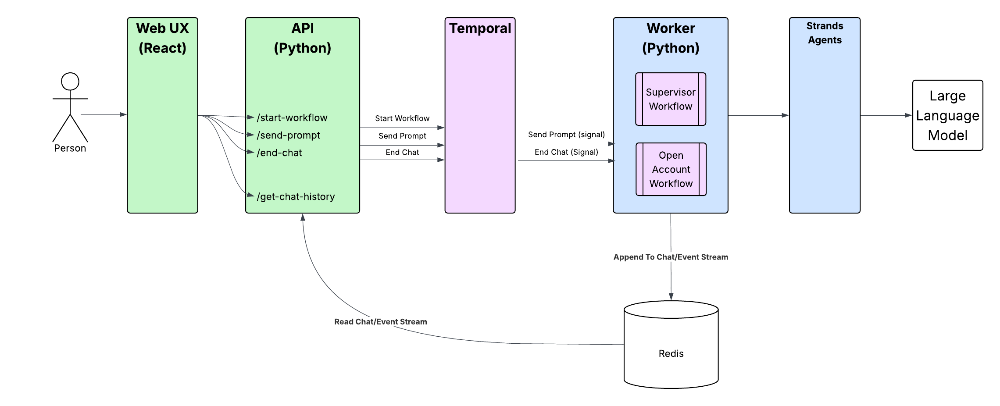

# Wealth Management Agent Example using Temporal + Strands

Demonstrates how to make the [Strands Agents](https://strandsagents.com/) wealth
management assistant **durable** by running it inside a
[Temporal](https://temporal.io) Workflow with the
[`StrandsPlugin`](https://docs.temporal.io/develop/python/integrations/strands-agents),
and driving it from a **React frontend** through a **FastAPI** backend. The plugin routes every model invocation and tool call through
Temporal Activities, so each step is recorded in Workflow history and survives
crashes, restarts, and infrastructure failures.

The vanilla Strands (CLI) version of this example is located [here](../strands_supervisor/README.md).

## Application architecture



The React frontend uses adaptive polling (2s while awaiting the assistant, 5s
otherwise) to read new events from Redis via the API, giving real-time status
updates as the open-account child workflow progresses.

## What this demonstrates

| Temporal feature | Where |
|---|---|
| **Durable model + tool calls** | `TemporalAgent` in `workflows/supervisor_workflow.py` |
| **Agents as tools (nested)** | The supervisor delegates to `beneficiary_assistant` / `investment_assistant`; the investment agent delegates opening onward to `open_account_assistant` (`_make_*_assistant`) |
| **Tools as Activities** | `activities/` wrapped with `activity_as_tool` |
| **Child workflow** | The open-account agent starts `OpenInvestmentAccountWorkflow` |
| **Human approval gate** | `ApprovalHook` interrupts before `delete_beneficiary` / `close_investment`; the workflow waits for an `approve` Signal |
| **Human compliance gate** | The open-account child blocks on a `compliance_approved` Signal, sent with `localsendcomplianceapproval.sh` (local server) or `sendcomplianceapproval.sh` (Temporal Cloud) |
| **Updates** | KYC reads and updates client details through the child workflow's `get_client_details` / `update_client_details` Updates |
| **Conversation history in Redis** | `EventStreamActivities` persist chat + status events the UI polls |
| **Retries, non-retryable errors, saga** | See [Failure scenarios](#failure-scenarios-chaos-panel) |
| **Task queue rate limiting** | Model calls on their own task queue, optionally capped with `LLM_MAX_CALLS_PER_SECOND` (`run_worker.py`) |
| **Polyglot child workflow** | Optional Java version of `OpenInvestmentAccountWorkflow` on its own task queue, calling the Python activities ([java/](../../java/README.md)) |
| **Claim check (payload codec)** | Optional: payloads stored in Redis, only their IDs sent to Temporal, with a codec server for the UI (`claim_check/`, `codec_server/`) |

The chat workflow keeps the whole conversation in one run; a production version
would need Continue-as-New for long conversations (see the TODO in
`workflows/supervisor_workflow.py`).

### A note on the agent topology

Strands has no agent-to-agent handoff primitive, so this version uses the Strands
["agents as tools"](https://strandsagents.com/latest/documentation/docs/user-guide/concepts/multi-agent/agents-as-tools/)
pattern, nested two levels deep: a supervisor `TemporalAgent` delegates each request
to a specialized sub-agent — itself a `TemporalAgent` — exposed to it as a tool
(`beneficiary_assistant`, `investment_assistant`). The **investment agent** in turn
owns account-opening and delegates it onward to a third sub-agent,
`open_account_assistant` (see `_make_*_assistant` in
`workflows/supervisor_workflow.py`). The `StrandsPlugin` routes every model
invocation and tool call through Activities, so each sub-agent's work is durably
recorded in the workflow history. Delegation is one-directional (caller → specialist);
a specialist never calls back up.

The beneficiary and investment agents are rebuilt per request, but the
**open-account agent is persistent**: it is built once and reused across customer
turns so it can hold
the open-account child-workflow ID while it walks the customer through KYC and waits
for compliance review — regardless of which agent invokes it, since it is keyed on
the workflow, not the caller. Opening an account is therefore owned by this dedicated
agent, which drives the durable `OpenInvestmentAccountWorkflow` child workflow, and
is reached via the investment agent rather than from the supervisor directly.

The CLI-only
[`strands_supervisor`](../strands_supervisor/README.md) version uses the same
"agents as tools" topology without the Temporal durability layer (there, opening an
account is a single synchronous tool inside the investment agent rather than a child
workflow).

## Prerequisites

* [uv](https://docs.astral.sh/uv/) and Python 3.10 or later
* [Node.js](https://nodejs.org/) 18+ and npm (for the React frontend)
* A [Gemini API key](https://aistudio.google.com/api-keys)
* [Temporal CLI](https://docs.temporal.io/cli#install)
* [Redis](https://redis.io/downloads/) (chat history, status updates, chaos flags, and the optional claim check)
* [Java JDK 25](https://adoptium.net/) — optional, only for the [Java open-account workflow](#run-with-the-java-open-account-workflow-optional) (the Gradle wrapper is included)

## Setup

From the project root:

```bash
uv sync
cp setgeminikey.example setgeminikey.sh   # then edit and paste your key
```

The worker, API, and chat scripts `cd` to the project root and source
`setgeminikey.sh` if it exists, so they can be run from any directory.

Start Redis and a local Temporal dev server in separate terminals:

```bash
redis-server
```

```bash
temporal server start-dev
```

Redis location can be overridden with `REDIS_HOST` / `REDIS_PORT` (see
[Environment variables](#environment-variables)).

## Run the demo (local)

**1. Start the worker** (terminal 1, from the project root):

```bash
src/temporal_supervisor/startlocalworker.sh
```

**2. Start the API** (terminal 2, from the project root):

```bash
src/api/startlocalapi.sh        # uvicorn on http://127.0.0.1:8000
```

**3. Start the React frontend** (terminal 3, from the project root):

```bash
cd src/frontend
npm install      # first time only
npm start        # opens http://localhost:3000
```

To run the open-account child workflow in Java instead, see
[Run with the Java open-account workflow](#run-with-the-java-open-account-workflow-optional).

Click **Start Chat**, then try client ID `123` or `234`. Questions that aren't
about beneficiaries or investment accounts are politely declined by the supervisor
agent (handled in its prompt).

### Human approval (delete / close)

When you ask to delete a beneficiary or close an investment account, the
sub-agent's `ApprovalHook` interrupts before the tool runs and the workflow
pauses. The bot asks for confirmation inline in the chat (for example "Are you
sure you want to delete beneficiary John Doe?"). Answer by typing: a reply that
starts with *yes*, *y*, *ok*, *sure*, *approve*, *confirm*, *proceed* (and a few
similar words) approves; anything else denies. The UI sends your answer to
`POST /approve` (`response=approve` or `deny`), which signals the workflow, and
the agent either runs the tool or tells you it wasn't done.

### How the Open Account functionality works

1. You ask to open an account. The supervisor routes to `investment_assistant`,
   which hands the whole flow to the persistent `open_account_assistant`.
2. Its `open_new_investment_account` tool checks the business rules
   (`validate_new_account`: at least $100, at most $1,000,000), looks up any
   promotion (`find_promotion`), and starts the `OpenInvestmentAccountWorkflow`
   child workflow with the ID `OpenAccount-<chat workflow ID>-<client ID>-<account name>-<n>`
   (the same format as the other ports), where `<n>` counts the account openings
   started in this conversation, this one included (1, 2, 3, ...). The child loads
   the client and waits for KYC. Each request to open an account starts a new
   account opening with its own KYC, even if an account with the same name was
   opened, or is still being opened, earlier in the conversation: asking for
   Vacation twice gives two openings, `...-Vacation-1` and `...-Vacation-2`, which
   can both be pending at once. A request refused by the business rules starts
   nothing and does not use up a number.
3. **KYC:** the agent shows your current details (`get_current_client_info`, an
   Update on the child) and asks whether they are correct. It can approve KYC
   (`approve_kyc`, a `verify_kyc` Signal) only after you confirm in a later
   message; if details need changing, `update_client_details` (an Update) saves
   them and also completes KYC.
4. The child moves to **Waiting Compliance Review** and waits for the
   `compliance_approved` Signal, sent by an employee with the script below.
5. **Saga:** the child creates the account record, transfers the deposit from the
   linked bank account, and registers the account with the custodian. If a step
   fails non-retryably, the completed steps are undone in reverse order (refund,
   then remove the account) and the status ends with "Rolled back".
6. Each state change is signalled to the chat workflow
   (`update_account_opening_state`), shown in the UI status area as
   `New <account> account status changed: <state>`, and read by the agent with its
   `get_account_opening_status` tool, so it reports the real status instead of
   what it remembers. "Complete" means the account was opened.

The **Bug in workflow code** chaos switch adds a welcome-bonus promo code that
pauses the child after compliance approval; see
[Bug in the workflow code](#bug-in-the-workflow-code).

### Approving compliance

Compliance approval is sent from a terminal (there is no button in the UI). The
script `cd`s to the project root, so it can be run from any directory:

```bash
# local Temporal server
src/temporal_supervisor/localsendcomplianceapproval.sh <child-workflow-id>
# Temporal Cloud (sources setcloudenv.sh from the project root)
src/temporal_supervisor/sendcomplianceapproval.sh <child-workflow-id>
```

The status text does not include the child workflow ID. Its format is
`OpenAccount-<chat workflow ID>-<client ID>-<account name>-<n>`, where `<n>` counts
the account openings started in the conversation, for example
`OpenAccount-strands-temporal-agent-k3j9x2m1q-123-Vacation-1`. To find it, open
the [Temporal UI](http://localhost:8233), look for the **Running**
`OpenInvestmentAccountWorkflow` (a child of your chat workflow, whose ID starts
with `strands-temporal-agent-`) and copy its Workflow ID. You can also list them
with the Temporal CLI:

```bash
temporal workflow list --query "WorkflowType='OpenInvestmentAccountWorkflow' AND ExecutionStatus='Running'"
```

The account name is used as is, so quote the ID if it contains spaces, e.g.
`src/temporal_supervisor/localsendcomplianceapproval.sh "OpenAccount-strands-temporal-agent-k3j9x2m1q-123-Kids College-2"`.
Every request to open an account is a new opening with its own ID, so if you asked
for the same account name twice the list shows both (`...-Vacation-1` and
`...-Vacation-2`); approve the one whose KYC you confirmed.

The signal waits until KYC has been approved, so send it after you have confirmed
your details.

### Testing the open-account workflow on its own

`startlocalopenaccount.sh` exercises `OpenInvestmentAccountWorkflow` without the chat or the LLM
(no Gemini key needed). It starts a Python worker in the background, runs
`run_open_account_workflow.py`, and stops the worker when it finishes. The script runs three
scenarios for client `123`, each starting the workflow directly:

1. KYC approved (`verify_kyc`), then compliance approved.
2. Client details read (`get_client_details`) and changed (`update_client_details`, which completes
   KYC: client 123's last name becomes "Doenut"), then compliance approved.
3. KYC approved, then the workflow waits in `Waiting Compliance Review` until you send the approval
   yourself. The script prints the command, for example
   `src/temporal_supervisor/localsendcomplianceapproval.sh testing-open-account-<run>-3`.

Temporal must be running (Redis too, for the chaos flags the activities read). From the project root:

```bash
src/temporal_supervisor/startlocalopenaccount.sh
```

With a task queue name, the workflow runs on that queue, so you can run the same scenarios against
the Java workflow (start `java/startlocalworker.sh <queue>` first):

```bash
src/temporal_supervisor/startlocalopenaccount.sh Open-Account-Java
```

Further arguments go to `run_open_account_workflow.py`: `--scenario N` (repeatable) runs only some
scenarios, and `--amount X` sets the initial deposit, e.g. `--scenario 1 --amount 300000` to see the
saga roll back (client 123's linked bank account has less than that). Each run uses new workflow IDs
(`testing-open-account-<run>-<scenario>`). Like the demo, the scenarios change `data/*.json`.

### Resetting the demo data

Opening and closing accounts and editing beneficiaries change the JSON files in
`data/` (the saga also changes linked bank account balances in
`data/funding_accounts.json`). Restore them from the project root with
`git checkout data/`.

## Run with the Java open-account workflow (optional)

[`java/`](../../java/README.md) has a Java (Spring Boot) version of `OpenInvestmentAccountWorkflow`
with the same states, updates, signals, saga and status updates as the Python version. It calls the
Python activities by name on the Python worker's task queue. To use it, give both workers the same
open-account task queue name. From the project root:

```bash
src/temporal_supervisor/startlocalworker.sh Open-Account-Java   # terminal 1
java/startlocalworker.sh Open-Account-Java                      # terminal 2 (needs JDK 25)
```

The argument sets `TEMPORAL_TASK_QUEUE_OPEN_ACCOUNT`. The supervisor then starts the child workflow
on that queue, and the Python worker doesn't register the Python version of the workflow (it still
runs all the activities, including the ones the Java workflow calls). Without an argument everything
runs in Python, as before. Start the API and frontend and approve compliance as usual. For Temporal
Cloud, use `src/temporal_supervisor/startcloudworker.sh Open-Account-Java` and
`java/startcloudworker.sh Open-Account-Java`; see [java/README.md](../../java/README.md).

## Claim check (optional)

The [claim check pattern](https://www.enterpriseintegrationpatterns.com/patterns/messaging/StoreInLibrary.html)
replaces the data sent to Temporal (workflow and activity inputs and results, signals, updates, model
calls) with an ID, and stores the data in Redis. A
[custom payload codec](https://docs.temporal.io/develop/python/converters-and-encryption#custom-payload-codec)
(`claim_check/claim_check_codec.py`) does the substitution, and `claim_check/claim_check_plugin.py`
adds it to the StrandsPlugin's data converter. Every Temporal client (worker, API, CLI chat,
compliance-approval and open-account scripts, and the open-account activities) is built by
`connect_client` in `client_helper.py`, which adds the plugin only when `USE_CLAIM_CHECK=true`. The
Java worker has the same codec, so the two can be mixed.

From the project root:

```bash
cp setclaimcheck.example setclaimcheck.sh
```

It contains:

```bash
export USE_CLAIM_CHECK=true
export REDIS_HOST=localhost
export REDIS_PORT=6379
```

All the start scripts (worker, API, CLI chat, compliance approval, codec server, the open-account
scenarios and the Java workers) source `setclaimcheck.sh` from the project root if it exists, and run
without claim check if it doesn't. Turn it on for every component or none: a client without the
codec can't read claim-checked payloads. Redis must be running; the same Redis holds the chat history
and the stored payloads. Every payload costs a round trip to Redis, and Redis downtime stops the
workflows, so a production deployment needs a highly available store.

### Codec server

With claim check on, the Temporal UI shows only the IDs. To see the real payloads, run the codec
server (it reads the same `setclaimcheck.sh`):

```bash
src/temporal_supervisor/startcodecserver.sh     # http://127.0.0.1:8081
```

Open the Temporal UI at exactly http://localhost:8233 (not 127.0.0.1): the codec server only accepts
requests (CORS) from http://localhost:8233 and https://cloud.temporal.io. Click the glasses icon in
the upper right, choose "Use my browser setting and ignore Cluster-level setting", enter
`http://127.0.0.1:8081` (no trailing spaces), turn off "Pass the user access token" and "Include
cross-origin credentials", and click **Apply**. The event history now shows the decoded payloads.

## Failure scenarios (chaos panel)

Click **Chaos** in the chat header to open the chaos panel. Its switches inject
failures at runtime: activities and the model read the flags from Redis on every
attempt, so you can turn a failure on and off mid-conversation without restarting
anything. The panel also lists each injected failure as it happens (activity and
attempt number). Open the [Temporal UI](http://localhost:8233) alongside it to show
the pending activity, its attempt count, and the last failure. **Reset all** turns
every flag off.

| Scenario | How to show it | What Temporal does |
|---|---|---|
| **Tool / API down** | Turn on *Core banking API down*, then ask to list your investments (or open an account, so it fails after compliance approval). Turn it off. | The activity retries (1s backoff, capped at 5s) for as long as the outage lasts. The agent waits mid-turn and answers once the API is back. Nothing is lost or re-asked. |
| **LLM down** | Turn on *Gemini API down* and send a message. Turn it off. | The model call is an activity, so it retries the same way (backoff capped at 10s). The conversation picks up exactly where it was. |
| **LLM rate limited (reactive)** | Turn on *Gemini rate limited (429)* and send a message. | The model raises an `ApplicationError` with `next_retry_delay` (15s, like a `Retry-After` header), which overrides the retry policy's backoff. Real Gemini 429s are handled the same way (`ChaosAwareGeminiModel` in `model_config.py`). |
| **LLM rate limited (proactive)** | Start the worker with `LLM_MAX_CALLS_PER_SECOND=0.2 src/temporal_supervisor/startlocalworker.sh`, then chat in several browser tabs at once. | Model calls run on their own task queue (`wealth-management-strands-llm` by default; set with `TEMPORAL_TASK_QUEUE_LLM`). The Temporal service dispatches at most that many per second across *all* workers, so calls queue up instead of hitting the provider's limit. Tools on the main queue aren't slowed down. |
| **Business rule (non-retryable)** | Ask to open an account with $2,000,000 (or less than $100). | `validate_new_account` raises a non-retryable `ApplicationError`: one attempt, no retries. The reason goes back to the agent, which explains it to the customer. Compare it with *Tool / API down* in the Temporal UI. |
| **Saga** | Turn on *Custodian rejects new accounts* (and *Slow account-opening steps* so you can watch), then open an account through compliance approval. Without flags: as client `123`, open an account with $300,000 (the linked bank account has $250,000). | After compliance approval the child workflow creates the account record, transfers the deposit from the linked bank account, and registers with the custodian. When a step fails non-retryably, the completed steps are undone in reverse order (refund, then remove the account). Compensations are activities too, so they are retried until they succeed. Kill the worker mid-rollback and the rollback still finishes. Transfers are idempotent (the transfer ID is `<child workflow ID>-<run ID>-initial-deposit`, refunds `...-refund`), so a retried debit or refund never moves money twice, while opening an account with the same name again after a rollback is a new opening with a new child workflow ID, and so a new transfer. |
| **Bug in workflow code** | Turn on *Bug in workflow code*, then open an account through compliance approval. See below. | The workflow pauses at the failing line, keeping all its state, until a worker with fixed code picks it up. |

### Bug in the workflow code

Turn on **Bug in workflow code**, then open an account and approve KYC and
compliance. While the switch is on, `find_promotion` gives new account openings a
`WELCOME-BONUS` promo code, which is passed to `OpenInvestmentAccountWorkflow` as
part of its input. The welcome-bonus code path (`_welcome_bonus` in
`workflows/open_account_workflow.py`) has a real bug: it reads
`inputs.initial_deposit`, a field that doesn't exist. Openings without the promo
code never reach it.

Right after compliance approval, the workflow raises `AttributeError:
'OpenInvestmentAccountInput' object has no attribute 'initial_deposit'`. In the
Python SDK an ordinary exception fails the *workflow task*, not the workflow, so
the workflow stays **Running**, paused at that point with the compliance approval
intact. The Temporal UI shows the failing workflow task and its stack trace.
Other conversations, and openings without the promo code, keep working.

Turning the switch off doesn't help: the promo code is part of the workflow's
input, so every retry hits the same line. The fix is code. Change
`inputs.initial_deposit` to `inputs.initial_amount` and restart the worker. The
workflow resumes on the server's next workflow-task retry and opens the account
with the bonus.

Workflow-task retries back off over time, up to 10 minutes. If the fix is
deployed within a couple of minutes, the workflow resumes within about a minute.

After the demo, re-arm the bug:

```bash
git checkout src/temporal_supervisor/workflows/open_account_workflow.py
```

### With the Java open-account workflow

All the scenarios work the same way with the [Java workflow](#run-with-the-java-open-account-workflow-optional):
it calls the Python activities, which read the chaos flags. The bug in the workflow code is different
in Java: `BONUS_RATES` in
`java/src/main/java/io/temporal/demo/wealthmanagement/workflow/OpenInvestmentAccountWorkflowImpl.java`
is keyed by `"WELCOME_BONUS"` (underscore), but the promo code is `"WELCOME-BONUS"` (hyphen), so
`welcomeBonus` throws a `NullPointerException`. As in Python, it fails the workflow task, not the
workflow, so it stays **Running**. The fix is the commented-out line above it; restart the Java worker
after fixing it, and re-arm the bug afterwards with:

```bash
git checkout java/src/main/java/io/temporal/demo/wealthmanagement/workflow/OpenInvestmentAccountWorkflowImpl.java
```

### Optional: CLI client

A command-line client is included for quick testing without the frontend/API (the
worker must be running):

```bash
src/temporal_supervisor/startchat.sh
```

It starts a new chat workflow (ID `wealth-management-<uuid>`, printed at start)
and prints status updates as `[status] ...`. When a delete or close needs
approval it prints `[approval needed] <question>` and asks `Approve? (yes/no)`;
`y`, `yes`, or `approve` approves and anything else denies. Type `exit`, `quit`,
or `end` to stop.

## API endpoints

`src/api/main.py` (FastAPI, started by `src/api/startlocalapi.sh` or
`src/api/startcloudapi.sh` on http://127.0.0.1:8000). Needs Temporal, Redis, and the
worker running. CORS allows the frontend on port 3000 (`localhost` and `127.0.0.1`).
All parameters are query parameters.

| Method | Path | Parameters | What it does |
|---|---|---|---|
| GET | `/` | | Health message |
| POST | `/start-workflow` | `workflow_id` | Starts a `WealthManagementWorkflow` |
| POST | `/send-prompt` | `workflow_id`, `prompt` | Signals a customer message |
| GET | `/get-chat-history` | `workflow_id`, `from_index` (default 0) | Chat and status events from Redis |
| GET | `/pending-approval` | `workflow_id` | The pending delete/close confirmation question, or `null` |
| POST | `/approve` | `workflow_id`, `response` (`approve` or `deny`) | Answers the pending confirmation |
| POST | `/end-chat` | `workflow_id` | Signals the workflow to end |
| GET | `/chaos` | | Chaos flags and recent injected failures |
| POST | `/chaos` | `flag`, `enabled` | Turns one chaos flag on or off |
| POST | `/chaos/reset` | | Turns every flag off and clears the failure log |

## Environment variables

| Variable | Default | Used for |
|---|---|---|
| `GEMINI_API_KEY` (or `GOOGLE_API_KEY`) | | Gemini API key (worker) |
| `TEMPORAL_ADDRESS` | `localhost:7233` | Temporal service address |
| `TEMPORAL_NAMESPACE` | `default` | Temporal namespace |
| `TEMPORAL_TLS_CLIENT_CERT_PATH` / `TEMPORAL_TLS_CLIENT_KEY_PATH` | | mTLS cert and key for Temporal Cloud (both must be set) |
| `TEMPORAL_TASK_QUEUE` | `wealth-management-strands` | Main task queue (workflows and tools). Set the same value for the worker, API, and CLI client |
| `TEMPORAL_TASK_QUEUE_LLM` | `<TEMPORAL_TASK_QUEUE>-llm` | Task queue for model calls. The older name `TEMPORAL_LLM_TASK_QUEUE` is still accepted |
| `LLM_MAX_CALLS_PER_SECOND` | unset (no limit) | Max model calls per second dispatched from the LLM queue, across all workers |
| `TEMPORAL_TASK_QUEUE_OPEN_ACCOUNT` | `<TEMPORAL_TASK_QUEUE>` | Task queue the open-account child workflow is started on. Set it with the argument to `startlocalworker.sh` / `startcloudworker.sh` (and pass the same name to `java/startlocalworker.sh` / `java/startcloudworker.sh`). When it differs from `TEMPORAL_TASK_QUEUE`, the Python worker doesn't register `OpenInvestmentAccountWorkflow` |
| `REDIS_HOST` / `REDIS_PORT` | `localhost` / `6379` | Redis for chat history, status updates, chaos flags, and claim check payloads |
| `USE_CLAIM_CHECK` | `false` | `true` turns on the claim check codec (`setclaimcheck.sh`); see [Claim check](#claim-check-optional) |

The scripts pass the environment through, so you can prefix any of them, e.g.
`LLM_MAX_CALLS_PER_SECOND=0.2 src/temporal_supervisor/startlocalworker.sh`.

## Tests

From the project root:

```bash
uv run pytest
```

The tests cover the durable approval gate across sub-agents, the KYC guard (including
opening the same account name twice: two child workflows, each with its own KYC), the
failure scenarios (saga rollback, a new transfer ID per run, retries, tool and LLM outages retried until
recovery, the workflow bug), the off-topic
prompt, and the claim check codec, plugin and codec server and the open-account
task-queue split (`tests/test_claim_check.py`). They use a scripted model, stub
activities and an in-memory stand-in for Redis, so no Gemini key or Redis is
needed; the Temporal test server is downloaded automatically on first run.

The Java workflow has its own tests (JDK 25):

```bash
cd java
./gradlew test
```

### Live agent-routing test (calls the paid Gemini API)

`tests/live_agent_handoffs.py` runs the real `WealthManagementWorkflow` against the
real Gemini model, with the real beneficiary and investment activities (they only
read `data/*.json`). Only the Redis-backed event stream activities are replaced with
in-memory stand-ins, and the chaos flags are stubbed off, so no Redis is needed. The
customer asks "Who are my beneficiaries?", gives client ID "123", then asks "What
investments do I have?". The test checks that the beneficiaries (John, Jane, Joan)
are listed, and that in the same turn the supervisor calls `investment_assistant`,
the Investment Agent runs, and the reply lists Checking, Savings and 401K without
mentioning a transfer or asking for the client ID again. It records every model
call with the agent that made it, checks that no agent said anything about
transferring the customer, and prints each run's transcript with that trace.

It is not part of `uv run pytest` (pytest only collects `test_*.py`) because it
calls the paid API, and it is skipped when `GEMINI_API_KEY` is not set. Run it from
the project root with:

```bash
source ./setgeminikey.sh && uv run pytest tests/live_agent_handoffs.py -s
```

Model output varies, so `LIVE_TEST_RUNS=<n>` repeats the conversation n times
(default 1), e.g. `LIVE_TEST_RUNS=10 uv run pytest tests/live_agent_handoffs.py -s`.

### Live account-opening tests (call the paid Gemini API)

`tests/live_account_opening.py` has two tests. Both run the real `WealthManagementWorkflow` and
`OpenInvestmentAccountWorkflow` against the real Gemini model.

`test_open_account_after_a_rollback`: the customer gives client ID "123", opens a Vacation account with $18,500 and confirms their details;
the test then sends the compliance approval, the custodian rejects the account and
the saga rolls it back. The customer opens Vacation again ($15,000), confirms, and
lists their investments. The test checks that no agent says the account is open
before it is, that the second request starts a new account opening with its own KYC
instead of reporting the rolled-back one as pending, that account-opening replies
don't end with the "open, close, or list" next steps, that the two openings use the
child workflow IDs `OpenAccount-<chat workflow ID>-123-Vacation-1` and `...-Vacation-2`,
and that each investment is listed on its own line.

`test_open_the_same_account_twice`: the customer asks "Who are my beneficiaries?",
gives client ID "123", asks what investments they have, opens Vacation with $13,000,
confirms their details (the opening now waits for compliance review), then asks to
open Vacation with $13,000 again. The test checks that both open requests show the
client's details for KYC ("Don", "123 Main Street") and that two child workflows
were started, ending `-Vacation-1` and `-Vacation-2`.

The read-only activities use the real `data/*.json`; the saga steps (the custodian always rejects), the KYC activities,
the Redis-backed event stream and the chaos flags are stubbed, so it never changes
the data files and needs no Redis.

Like the routing test, they are not part of `uv run pytest` and are skipped when
`GEMINI_API_KEY` is not set. Each run is a six-message conversation through up to
three nested agents, so it makes many more model calls than the routing test and
costs correspondingly more; `LIVE_TEST_RUNS=<n>` multiplies that. Run it from the
project root with:

```bash
source ./setgeminikey.sh && uv run pytest tests/live_account_opening.py -s
# only one of them:
source ./setgeminikey.sh && uv run pytest tests/live_account_opening.py -k same_account_twice -s
```

## Run on Temporal Cloud

Redis still runs locally. From the project root:

```bash
cp src/temporal_supervisor/setcloudenv.example setcloudenv.sh   # edit with your namespace + mTLS cert paths
# terminal 1 (worker; the script sources setcloudenv.sh, setgeminikey.sh and setclaimcheck.sh itself):
src/temporal_supervisor/startcloudworker.sh
# terminal 2 (API; the script sources setcloudenv.sh itself):
src/api/startcloudapi.sh
# terminal 3 (frontend):
cd src/frontend && npm install && npm start
```

Running the worker by hand still works:
`source ./setcloudenv.sh && source ./setgeminikey.sh && uv run python src/temporal_supervisor/run_worker.py`.
To use the Java open-account workflow, pass the same task queue name to
`src/temporal_supervisor/startcloudworker.sh <queue>` and `java/startcloudworker.sh <queue>` (see
[java/README.md](../../java/README.md#running-with-temporal-cloud)).

`connect_client` (`client_helper.py`) reads `TEMPORAL_ADDRESS`,
`TEMPORAL_NAMESPACE`, and the `TEMPORAL_TLS_CLIENT_CERT_PATH` /
`TEMPORAL_TLS_CLIENT_KEY_PATH` env vars.

Send the compliance approval with the cloud script, which sources `setcloudenv.sh`
itself:

```bash
src/temporal_supervisor/sendcomplianceapproval.sh <child-workflow-id>
```

`startchat.sh` does not source `setcloudenv.sh`; to use the CLI chat client against
Temporal Cloud, run `source ./setcloudenv.sh` in your shell first.

Find the child workflow ID in your namespace in the Temporal Cloud UI, as described
in [Approving compliance](#approving-compliance).
