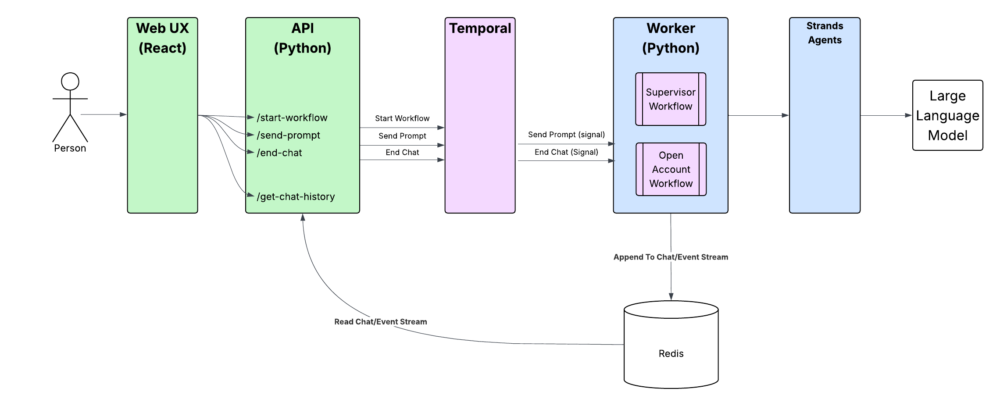

# Wealth Management Agent Example using Temporal + Strands

Demonstrates how to make the [Strands Agents](https://strandsagents.com/) wealth
management assistant **durable** by running it inside a
[Temporal](https://temporal.io) Workflow with the
[`StrandsPlugin`](https://docs.temporal.io/develop/python/integrations/strands-agents),
and driving it from a **React frontend** through a **FastAPI** backend (just like
the ADK version). The plugin routes every model invocation and tool call through
Temporal Activities, so each step is recorded in Workflow history and survives
crashes, restarts, and infrastructure failures.

The vanilla Strands (CLI) version of this example is located [here](../strands_supervisor/README.md).

## Application architecture



The React frontend uses adaptive polling (2s while awaiting the assistant, 5s
otherwise) to read new events from Redis via the API, giving real-time status
updates as the open-account child workflow progresses.

## What this demonstrates

| Temporal feature | Where |
|---|---|
| **Durable model + tool calls** | `TemporalAgent` in `workflows/supervisor_workflow.py` |
| **Agents as tools (nested)** | The supervisor delegates to `beneficiary_assistant` / `investment_assistant`; the investment agent delegates opening onward to `open_account_assistant` (`_make_*_assistant`) |
| **Tools as Activities** | `activities/` wrapped with `activity_as_tool` |
| **Child workflow** | The open-account agent starts `OpenInvestmentAccountWorkflow` |
| **Human approval gate** | `ApprovalHook` interrupts before `delete_beneficiary` / `close_investment`; UI shows Approve/Deny |
| **Human compliance gate** | The open-account child blocks on a `compliance_approved` Signal; UI shows "Approve Compliance" |
| **Continue-as-New** | The chat workflow carries `agent.messages` forward when history grows large |
| **Conversation history in Redis** | `EventStreamActivities` persist chat + status events the UI polls |
| **Retries, non-retryable errors, saga** | See [Failure scenarios](#failure-scenarios-chaos-panel) |
| **Task queue rate limiting** | Model calls on their own task queue, optionally capped with `LLM_MAX_CALLS_PER_SECOND` (`run_worker.py`) |

### A note on the agent topology

The ADK version uses ADK `sub_agents` with automatic LLM "transfer". Strands has
no transfer primitive, so this version uses the Strands
["agents as tools"](https://strandsagents.com/latest/documentation/docs/user-guide/concepts/multi-agent/agents-as-tools/)
pattern, nested two levels deep: a supervisor `TemporalAgent` delegates each request
to a specialized sub-agent — itself a `TemporalAgent` — exposed to it as a tool
(`beneficiary_assistant`, `investment_assistant`). The **investment agent** in turn
owns account-opening and delegates it onward to a third sub-agent,
`open_account_assistant` (see `_make_*_assistant` in
`workflows/supervisor_workflow.py`). The `StrandsPlugin` routes every model
invocation and tool call through Activities, so each sub-agent's work is durably
recorded in the workflow history. Delegation is one-directional (caller → specialist);
a specialist never calls back up.

The beneficiary and investment agents are rebuilt per request, but the
**open-account agent is persistent**: it is built once and reused across customer
turns (its message history is even carried across Continue-as-New) so it can hold
the open-account child-workflow ID while it walks the customer through KYC and waits
for compliance review — regardless of which agent invokes it, since it is keyed on
the workflow, not the caller. Opening an account is therefore owned by this dedicated
agent, which drives the durable `OpenInvestmentAccountWorkflow` child workflow, and
is reached via the investment agent rather than from the supervisor directly.

The scenarios are identical to the ADK demo; only the internal topology differs to
fit the Strands + Temporal integration. The CLI-only
[`strands_supervisor`](../strands_supervisor/README.md) version uses the same
"agents as tools" topology without the Temporal durability layer (there, opening an
account is a single synchronous tool inside the investment agent rather than a child
workflow).

## Prerequisites

* [uv](https://docs.astral.sh/uv/)
* [Node.js](https://nodejs.org/) 18+ and npm (for the React frontend)
* A [Gemini API key](https://aistudio.google.com/api-keys)
* [Temporal CLI](https://docs.temporal.io/cli#install)
* [Redis](https://redis.io/downloads/)

## Setup

From the project root:

```bash
uv sync
cp setgeminikey.example setgeminikey.sh   # then edit and paste your key
```

Start Redis and a local Temporal dev server in separate terminals:

```bash
redis-server
```

```bash
temporal server start-dev
```

Redis location can be overridden with `REDIS_HOST` / `REDIS_PORT`.

## Run the demo (local)

**1. Start the worker** (terminal 1, from the project root):

```bash
src/temporal_supervisor/startlocalworker.sh
```

**2. Start the API** (terminal 2):

```bash
src/api/startlocalapi.sh        # uvicorn on http://127.0.0.1:8000
```

**3. Start the React frontend** (terminal 3):

```bash
cd src/frontend
npm install      # first time only
npm start        # opens http://localhost:3000
```

Click **Start Chat**, then try client ID `123` or `234`.

### Human approval (delete / close)

When you ask to delete a beneficiary or close an investment account, the agent
interrupts and the UI shows an **Approve / Deny** banner. The status area also
reflects the pending approval. The agent resumes once you respond.

### Opening an account + compliance approval

When you open an investment account, the agent starts the child workflow and
walks you through KYC. The status area shows the progress; when the account is
**Waiting Compliance Review**, an **Approve Compliance** button appears. Click it
to send the `compliance_approved` Signal — the child workflow then creates the
account and reports `Complete`.

You can also approve compliance out-of-band from a terminal (the status text
includes the child workflow ID):

```bash
src/temporal_supervisor/sendcomplianceapproval.sh <child-workflow-id>
```

## Failure scenarios (chaos panel)

Click **Chaos** in the chat header to open the chaos panel. Its switches inject
failures at runtime: activities and the model read the flags from Redis on every
attempt, so you can turn a failure on and off mid-conversation without restarting
anything. The panel also lists each injected failure as it happens (activity and
attempt number). Open the [Temporal UI](http://localhost:8233) alongside it to show
the pending activity, its attempt count, and the last failure. **Reset all** turns
every flag off.

| Scenario | How to show it | What Temporal does |
|---|---|---|
| **Tool / API down** | Turn on *Core banking API down*, then ask to list your investments (or open an account, so it fails after compliance approval). Turn it off. | The activity retries (1s backoff, capped at 5s) for as long as the outage lasts. The agent waits mid-turn and answers once the API is back. Nothing is lost or re-asked. |
| **LLM down** | Turn on *Gemini API down* and send a message. Turn it off. | The model call is an activity, so it retries the same way. The conversation picks up exactly where it was. |
| **LLM rate limited (reactive)** | Turn on *Gemini rate limited (429)* and send a message. | The model raises an `ApplicationError` with `next_retry_delay` (15s, like a `Retry-After` header), which overrides the retry policy's backoff. Real Gemini 429s are handled the same way (`ChaosAwareGeminiModel` in `model_config.py`). |
| **LLM rate limited (proactive)** | Start the worker with `LLM_MAX_CALLS_PER_SECOND=0.2`, then chat in several browser tabs at once. | Model calls run on their own task queue (`wealth-management-strands-llm`). The Temporal service dispatches at most that many per second across *all* workers, so calls queue up instead of hitting the provider's limit. Tools on the main queue aren't slowed down. |
| **Business rule (non-retryable)** | Ask to open an account with $2,000,000 (or less than $100). | `validate_new_account` raises a non-retryable `ApplicationError`: one attempt, no retries. The reason goes back to the agent, which explains it to the customer. Compare it with *Tool / API down* in the Temporal UI. |
| **Saga** | Turn on *Custodian rejects new accounts* (and *Slow account-opening steps* so you can watch), then open an account through compliance approval. Without flags: as client `123`, open an account with $300,000 (the linked bank account has $250,000). | After compliance approval the child workflow creates the account record, transfers the deposit from the linked bank account, and registers with the custodian. When a step fails non-retryably, the completed steps are undone in reverse order (refund, then remove the account). Compensations are activities too, so they are retried until they succeed. Kill the worker mid-rollback and the rollback still finishes. Transfers are idempotent, so a retried debit or refund never moves money twice. |
| **Bug in workflow code** | Turn on *Bug in workflow code*, then open an account through compliance approval. See below. | The workflow pauses at the failing line, keeping all its state, until a worker with fixed code picks it up. |

### Bug in the workflow code

Turn on **Bug in workflow code**, then open an account and approve KYC and
compliance. While the switch is on, `find_promotion` gives new account openings a
`WELCOME-BONUS` promo code, which is passed to `OpenInvestmentAccountWorkflow` as
part of its input. The welcome-bonus code path (`_welcome_bonus` in
`workflows/open_account_workflow.py`) has a real bug: it reads
`inputs.initial_deposit`, a field that doesn't exist. Openings without the promo
code never reach it.

Right after compliance approval, the workflow raises `AttributeError:
'OpenInvestmentAccountInput' object has no attribute 'initial_deposit'`. In the
Python SDK an ordinary exception fails the *workflow task*, not the workflow, so
the workflow stays **Running**, paused at that point with the compliance approval
intact. The Temporal UI shows the failing workflow task and its stack trace.
Other conversations, and openings without the promo code, keep working.

Turning the switch off doesn't help: the promo code is part of the workflow's
input, so every retry hits the same line. The fix is code. Change
`inputs.initial_deposit` to `inputs.initial_amount` and restart the worker. The
workflow resumes on the server's next workflow-task retry and opens the account
with the bonus.

Workflow-task retries back off over time, up to 10 minutes. If the fix is
deployed within a couple of minutes, the workflow resumes within about a minute.

After the demo, re-arm the bug:

```bash
git checkout src/temporal_supervisor/workflows/open_account_workflow.py
```

### Optional: CLI client

A command-line client is included for quick testing without the frontend/API:

```bash
src/temporal_supervisor/startchat.sh
```

## Run on Temporal Cloud

```bash
cp src/temporal_supervisor/setcloudenv.example setcloudenv.sh   # edit with your namespace + mTLS cert paths
# terminal 1:
source ./setcloudenv.sh && source ./setgeminikey.sh && uv run python src/temporal_supervisor/run_worker.py
# terminal 2:
src/api/startcloudapi.sh
# terminal 3:
cd src/frontend && npm start
```

`connect_client` reads `TEMPORAL_ADDRESS`, `TEMPORAL_NAMESPACE`, and the
`TEMPORAL_TLS_CLIENT_CERT_PATH` / `TEMPORAL_TLS_CLIENT_KEY_PATH` env vars.
